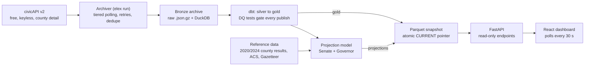
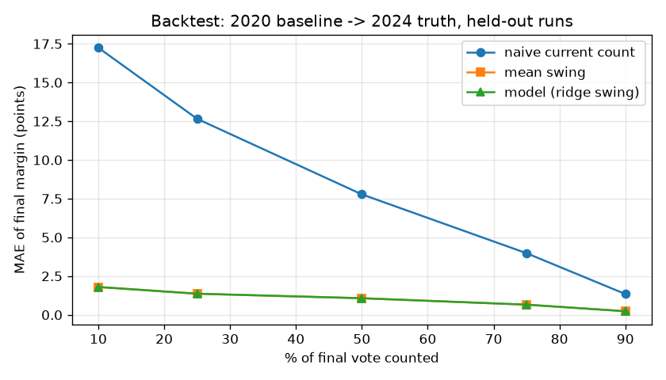

# elex-night

A live results pipeline for the 2026 US midterms, built on free data and run on a single small server:
it archives every change civicAPI publishes, validates it behind data-quality gates, serves a
county-level dashboard, and projects statewide margins with calibrated uncertainty.

Built on election night, November 3, 2026. The archiver went live at noon ET and ran through
the night; everything else was built against that archive while results came in.

## What it does



- **Archive first.** Every civicAPI response is written to disk as gzip JSON before anything
  else happens, deduplicated by content hash. 509 races (35 Senate, 39 Governor, 435 House)
  are polled in tiers; a search refresh pulls every race's totals in two requests when the
  per-race endpoints are slow.
- **Publish only what passes.** dbt builds the warehouse from the archive on every cycle;
  26 data-quality tests run with it. An error-severity failure blocks that cycle's publish,
  so the dashboard keeps the last good version instead of showing bad numbers.
- **Serve versioned Parquet, never the live database.** Each cycle exports a new serving
  version and swaps a `CURRENT` pointer atomically. The API reads only Parquet, so the
  archiver's write lock never reaches the dashboard, and any version can be rolled back to.
- **Project, never call.** Senate and Governor margins are projected from county swing
  against the 2024 presidential baseline, with Monte Carlo uncertainty bands. Winner flags
  shown on the dashboard are civicAPI's; the pipeline makes no race calls (ADR-003).

## Quick start

```bash
cp .env.example .env            # add CENSUS_API_KEY (free, from api.census.gov)
uv sync && (cd web && npm ci)
make check                      # ruff, 158 pytest, typecheck, 40 vitest; offline, ~30 s
uv run elex init-db && uv run elex discover --list
uv run elex load-ref            # county baselines, ACS features, turnout prior
make up                         # archiver + API + dashboard at http://localhost:8000
```

Useful commands: `elex cycle-once`, `elex sql "<query>"`, `elex project --race-id N`,
`elex backfill` (fill gaps from civicAPI race history), `make backtest`, `make dq`.

## The model, in six lines

For each Senate or Governor race: start from each county's 2024 presidential two-party
share and 2024 vote total. Expected turnout is a state prior (2022 ballots / 2024 votes)
updated from fully reported counties. In counties that have reported, measure the swing
from the baseline; fit the weighted mean swing over informative counties and apply it to
the counties still out. Add the uncounted votes at the projected share. Draw 2,000
scenarios with a shared state error (scaled by the standard error of the swing), independent
county errors, and a vote-type term for partially reported counties; report the median and
the 80% and 95% bands.

## Backtest

A simulated election night per state: 2020 presidential county shares as the baseline, 2024
results as the truth, counties revealed in random, smallest-first, largest-first and partial
(batch) orders. Tuned on random orders only; everything below is held out.

| % counted | MAE model | MAE raw count | 80% band holds truth | 95% band |
| --- | --- | --- | --- | --- |
| 25 | 1.36 pts | 12.66 | 0.75 | 0.92 |
| 50 | 1.07 | 7.78 | 0.77 | 0.94 |
| 75 | 0.66 | 3.98 | 0.83 | 0.94 |



The first calibration failed its coverage gate and the needle shipped disabled (ADR-005);
re-deriving the state error from the standard error of the swing and adding a vote-type
term for partially reported counties brought it inside the gates (ADR-006). A projection is
shown only once 25% of the expected vote is counted, the range the backtest validated.

## Data quality

Keys unique and non-null; `office` and `party_code` in their accepted sets; 0 <= percent
reporting <= 100 at race and county level; votes never negative; every county candidate
joins a race candidate; >= 99% of counties in statewide races map to a FIPS code; no test
data reaches gold; seat totals sum to 100 (Senate) and 435 (House). Warnings, not blocks:
vote totals that decrease (real corrections happen), county sums that lag race totals,
unknown party labels. Source freshness is measured on requests, not snapshots, because quiet
periods are normal.

## Replay

The night can be replayed from the archive and hosted as a static site with no server:

```bash
uv run elex replay --from 2026-11-03T23:00:00Z --every 10   # rebuild every 10 min step
uv run elex export-static                                    # one JSON set per step
cd web && VITE_REPLAY=1 npm run build                        # dashboard with a time slider
```

## Limitations

- civicAPI's per-race endpoints slowed to ~22 s and returned 502s for stretches of election
  night; the archive has gaps during those stretches that `elex backfill` fills from race
  history afterwards.
- The model's bands are overconfident when the largest counties report first and when
  early batches lean one way across a whole state; the order in which vote types are
  counted inside a county is only approximated.
- Maine and Alaska (ranked choice), Connecticut (no county crosswalk) and races without a
  D-vs-R contest are shown as counts only.
- Candidate photos come from Wikipedia and are shown only when the page clearly describes a
  politician; otherwise initials.

## Data

- [civicAPI](https://www.civicapi.org/) — live results (free, attribution required)
- County presidential results 2020/2024 — public mirror of county-level returns
- [US Census ACS](https://www.census.gov/programs-surveys/acs) 2024 5-year — county
  demographics; Census Gazetteer 2025 — land area
- [University of Florida Election Lab](https://election.lab.ufl.edu/) — 2022 turnout

Projections are estimates, not race calls.
