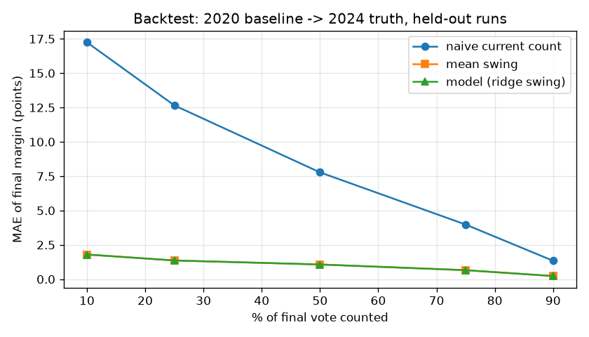

# Backtest

Simulated election nights: 2020 presidential county shares as the baseline, 2024 results as truth, 45 states (>= 10 counties, AK and CT excluded). Tuned on random orders seeds 0-2 (675 cases); evaluated on held-out random seeds 3-4, smallest-first, largest-first and partial reporting (1350 cases). Tuning rounds: 2.

**Chosen:** kappa = 0.1, sigma_nu = 0.0, alpha = 0.1. **All gates passed: True.**

## Gates (held-out)

| Gate | Pass | Values |
| --- | --- | --- |
| gate1_beats_naive_at_50 | yes | `{"smallest": {"model": 0.8581284341583589, "naive": 13.971460491099164}, "largest": {"model": 0.800635831714098, "naive": 14.494923730691562}}` |
| gate2_not_worse_than_mean_swing_at_50 | yes | `{"model": 1.0703230019766676, "mean_swing": 1.0703230019766676}` |
| gate3_coverage | yes | `{"25": {"cov80": 0.7518518518518519, "cov95": 0.9185185185185185}, "50": {"cov80": 0.7703703703703704, "cov95": 0.9444444444444444}, "75": {"cov80": 0.8296296296296296, "cov95": 0.9407407407407408}}` |
| gate4_speed_under_1s | yes | `{"seconds": 0.02553261094726622}` |

## Held-out metrics by checkpoint

| % counted | MAE model | MAE naive | MAE mean swing | bias | cov80 | cov95 | leader model | leader naive |
| --- | --- | --- | --- | --- | --- | --- | --- | --- |
| 10 | 1.80 | 17.25 | 1.80 | +0.78 | 0.66 | 0.86 | 0.98 | 0.79 |
| 25 | 1.36 | 12.66 | 1.36 | +0.70 | 0.75 | 0.92 | 0.99 | 0.86 |
| 50 | 1.07 | 7.78 | 1.07 | +0.67 | 0.77 | 0.94 | 0.99 | 0.90 |
| 75 | 0.66 | 3.98 | 0.66 | +0.36 | 0.83 | 0.94 | 0.99 | 0.95 |
| 90 | 0.23 | 1.34 | 0.23 | +0.13 | 0.87 | 0.96 | 1.00 | 0.98 |

Stress run (k0 = 0.9) and per-order metrics are in `backtest_metrics.json`; the full grid is in `backtest_grid.csv`.

Known limitation: the order in which vote types are counted inside a county (mail vs Election Day) is only approximated by the partial-reporting mode.
